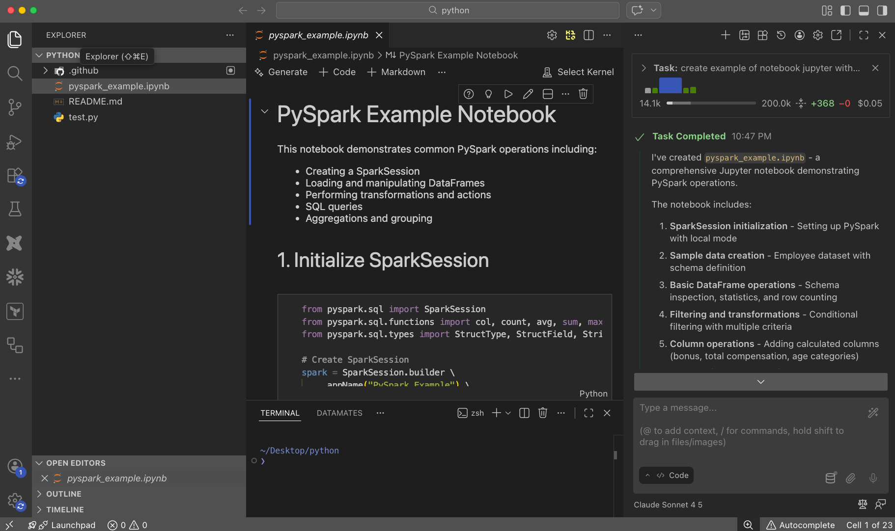

import { Aside, LinkCard, CardGrid } from '@astrojs/starlight/components';
import Resource from '../../../components/Resource.astro';
import ResourceList from '../../../components/ResourceList.astro';
import ResourceFilter from '../../../components/ResourceFilter.astro';

## Что это

AI-инструменты пишут код, SQL, тесты и документацию. Они разбирают ошибки и объясняют чужой код.
Сегодня это уже не просто чат. **Агенты** сами читают проект, запускают команды и делают Pull Request.
На этой странице — актуальные инструменты на ноябрь 2026 года и советы, как их выбрать.

<Aside type="caution" title="Всё быстро меняется">
Модели, цены и названия продуктов меняются каждый месяц. Цены указаны примерно (≈). Перед покупкой проверяйте на сайте.
</Aside>

## Как выбрать

| Задача | Что взять |
|---|---|
| Задать вопрос, объяснить концепцию, разобрать ошибку | Чат: Claude.ai, ChatGPT, Gemini |
| Найти информацию с источниками | Perplexity |
| Писать и менять код в проекте (dbt, Airflow, Python) | Агент в терминале: Claude Code, Codex |
| Работать с кодом в привычном редакторе | AI IDE: Cursor, Antigravity, Kiro или расширение для VS Code |
| Управлять несколькими агентами в одном окне | IDE для агентов: Orca |
| Команда агентов с ролями и общим списком задач | Оркестратор: Agent Teams, Gas Town |
| Работать с dbt, Snowflake, Databricks, BigQuery | Встроенный AI платформы и MCP-сервер |
| Код нельзя отправлять наружу | Локальные модели через Ollama |
| Нет доступа к зарубежным сервисам | GigaChat, Алиса AI, китайские модели |

**Стартовый набор инженера данных:**

1. **Claude Code** или **Codex** — основной агент для кода.
2. **Чат** (Claude.ai или ChatGPT) — для вопросов и черновиков.
3. **MCP-серверы** для вашей базы и dbt — агент видит схему и данные.
4. **Orca** — IDE для агентов, когда захотите запускать несколько агентов сразу.

## Ресурсы

<ResourceFilter />

<ResourceList title="Чат-боты">
  <Resource title="Claude.ai" href="https://claude.ai/" type="Сервис" level="Новичок" star tags={['Бесплатно', 'Платно']}>
    AI-ассистент от Anthropic. Хорошо пишет код, разбирает длинные документы и таблицы. Есть приложение Claude Desktop с режимом Cowork — агент работает с файлами на вашем компьютере. Планы: Free, Pro $20, Max $100, Ultra $200, Team. Claude Code входит в планы от Pro.
  </Resource>
  <Resource title="ChatGPT" href="https://chatgpt.com/" type="Сервис" level="Новичок" tags={['Бесплатно', 'Платно']}>
    Самый популярный чат-бот от OpenAI. Модели семейства GPT-6. Планы: Free, Go ≈$8, Plus ≈$20, Pro ≈$100–200, Business. Codex входит в подписку.
  </Resource>
  <Resource title="Gemini" href="https://gemini.google.com/" type="Сервис" level="Новичок" image="/assets/ai-tools/gemini.jpg" tags={['Бесплатно', 'Платно']}>
    AI-ассистент от Google. Интеграция с Gmail, Docs, Sheets и поиском Google. Планы: Free, AI Plus ≈$5, AI Pro ≈$20, AI Ultra от ≈$100.
  </Resource>
  <Resource title="Perplexity" href="https://www.perplexity.ai/" type="Сервис" level="Новичок" image="/assets/ai-tools/perplexity.jpg" tags={['Бесплатно', 'Платно']}>
    Поиск с AI. Всегда даёт ссылки на источники — удобно для исследований и проверки фактов. Планы: Free, Pro $20, Max $200. Есть бесплатный браузер Comet.
  </Resource>
  <Resource title="DeepSeek" href="https://chat.deepseek.com/" type="Сервис" level="Новичок" tags={['Бесплатно']}>
    Бесплатный чат от китайской компании DeepSeek. Сильная модель для кода и рассуждений. Не отправляйте туда рабочий код и данные.
  </Resource>
  <Resource title="Qwen Chat" href="https://chat.qwen.ai/" type="Сервис" level="Новичок" tags={['Бесплатно']}>
    Бесплатный чат от Alibaba с моделями Qwen. Хорошо работает с кодом и длинным контекстом.
  </Resource>
</ResourceList>

<ResourceList title="Российские инструменты">
  <Resource title="GigaChat" href="https://giga.chat/" type="Сервис" level="Новичок" lang="ru" image="/assets/ai-tools/gigachat.jpg" tags={['Бесплатно']}>
    AI-ассистент от Сбера. Работает в России без VPN, оплата российской картой. Есть API для своих приложений. Цены на платные планы проверяйте на сайте.
  </Resource>
  <Resource title="Алиса AI" href="https://alice.yandex.ru/" type="Сервис" level="Новичок" lang="ru" image="/assets/ai-tools/alice.jpg" tags={['Бесплатно', 'Платно']}>
    AI-ассистент Яндекса на моделях YandexGPT. Работает в России, есть подписка «Алиса Плюс». Для своих приложений — API YandexGPT в Yandex Cloud.
  </Resource>
</ResourceList>

<Aside type="note" title="Доступ из России">
OpenAI и Google официально не работают с Россией. Claude тоже недоступен напрямую. Варианты: российские сервисы, китайские модели (DeepSeek, Qwen, Kimi, GLM) через их API или OpenRouter. Подробно — в курсе [Claude Code 101, Модуль 10](/ai/claude-code-101/#способ-6-китайские-модели--deepseek-qwen-kimi-glm-minimax) и [Модуль 11](/ai/claude-code-101/#модуль-11-другие-ai-агенты-для-кода--codex-gemini-cursor-и-другие).
</Aside>

<ResourceList title="AI-агенты в терминале">
  <Resource title="Claude Code" href="https://code.claude.com/docs/en/overview" type="Инструмент" level="Средний" star image="/assets/ai-tools/claude-code.jpg" tags={['Платно', 'Mac', 'Linux', 'Windows']}>
    Агент от Anthropic. Читает проект, пишет код, запускает команды, работает с git. Поддерживает MCP, Skills, Hooks, Plugins, субагентов и Agent Teams. Есть расширения для VS Code и JetBrains. Наш курс: [Claude Code 101](/ai/claude-code-101/).
  </Resource>
  <Resource title="Codex" href="https://developers.openai.com/codex" type="Инструмент" level="Средний" tags={['Open source', 'Платно']}>
    Агент от OpenAI на моделях GPT-6. CLI с открытым кодом, расширение для IDE, приложение и облачные задачи. Инструкции читает из `AGENTS.md`. Входит в подписку ChatGPT.
  </Resource>
  <Resource title="Antigravity CLI" href="https://antigravity.google/" type="Инструмент" level="Средний" tags={['Бесплатно', 'Платно']}>
    Агент от Google, команда `agy`. С июня 2026 заменил Gemini CLI для личных аккаунтов. Gemini CLI остался для компаний и пользователей с API-ключом.
  </Resource>
  <Resource title="GitHub Copilot CLI" href="https://github.com/github/copilot-cli" type="Инструмент" level="Средний" tags={['Платно']}>
    Теперь это полноценный агент в терминале, а не только подсказка shell-команд. Работает с вашими репозиториями, issues и PR на GitHub.
  </Resource>
  <Resource title="OpenCode" href="https://opencode.ai/" type="Инструмент" level="Средний" image="/assets/ai-tools/opencode.jpg" tags={['Open source', 'Бесплатно']}>
    Агент с открытым кодом. Работает с любыми моделями: Claude, GPT, Gemini, китайскими и локальными. Хороший выбор, если нужна свобода выбора модели.
  </Resource>
  <Resource title="Junie CLI" href="https://www.jetbrains.com/junie/" type="Инструмент" level="Средний" image="/assets/ai-tools/junie.jpg" tags={['Платно']}>
    Агент от JetBrains. Работает в IDE JetBrains (PyCharm, DataGrip) и в терминале. Использует кредиты JetBrains AI.
  </Resource>
</ResourceList>

<ResourceList title="AI IDE и расширения">
  <Resource title="Orca" href="https://onorca.dev/" type="Инструмент" level="Средний" star image="/assets/ai-tools/orca-og.jpg" tags={['Open source', 'Бесплатно', 'Mac', 'Linux', 'Windows']}>
    IDE для агентов: запускает Claude Code, Codex и другие агенты параллельно, каждый в своём git worktree. Бесплатно, открытый код. Подробно — [ниже](#orca--ide-для-агентов).
  </Resource>
  <Resource title="Cursor" href="https://cursor.com/" type="Инструмент" level="Новичок" image="/assets/ai-tools/cursor.jpg" tags={['Платно']}>
    Редактор на базе VS Code с AI-агентом, чатом и автодополнением. Есть CLI (команда `agent`). Правила проекта — в `.cursor/rules/`. Сейчас принадлежит SpaceX, планы построены вокруг моделей Grok.
  </Resource>
  <Resource title="Devin Desktop (бывший Windsurf)" href="https://devin.ai/desktop" type="Инструмент" level="Новичок" image="/assets/ai-tools/devin-desktop.jpg" tags={['Платно']}>
    В июне 2026 компания Cognition переименовала Windsurf в Devin Desktop. Бренд Codeium больше не используется. Планы: Free, Pro ≈$20, Max ≈$200.
  </Resource>
  <Resource title="Google Antigravity" href="https://antigravity.google/" type="Инструмент" level="Новичок" image="/assets/ai-tools/antigravity.jpg" tags={['Бесплатно', 'Платно']}>
    Платформа агентов от Google: приложение, CLI `agy`, расширения для IDE и SDK. Есть бесплатный уровень, дальше — подписка Google AI.
  </Resource>
  <Resource title="Kiro" href="https://kiro.dev/" type="Инструмент" level="Средний" image="/assets/ai-tools/kiro.jpg" tags={['Бесплатно', 'Платно']}>
    AI IDE от AWS. Сначала пишет спецификацию, потом код. Заменил Amazon Q Developer. Удобен для работы с AWS. Планы от Free до $200.
  </Resource>
  <Resource title="Zed" href="https://zed.dev/" type="Инструмент" level="Средний" image="/assets/ai-tools/zed.jpg" tags={['Open source', 'Mac', 'Linux', 'Windows']}>
    Очень быстрый редактор с открытым кодом. Подключает внешних агентов: Claude Code, Codex и другие.
  </Resource>
  <Resource title="GitHub Copilot" href="https://github.com/features/copilot" type="Инструмент" level="Новичок" image="/assets/ai-tools/copilot.jpg" tags={['Платно']}>
    AI в VS Code, JetBrains и на GitHub. Автодополнение, чат, режим агента и Coding Agent, который сам делает PR из issue. Планы: Pro $10, Pro+ $39, Max $100, Business, Enterprise.
  </Resource>
  <Resource title="Cline" href="https://cline.bot/" type="Инструмент" level="Средний" image="/assets/ai-tools/cline.jpg" tags={['Open source', 'Бесплатно']}>
    Агент с открытым кодом для VS Code, есть CLI. Показывает каждое действие и спрашивает подтверждение. Работает с любыми моделями через API, OpenRouter или Ollama.
  </Resource>
  <Resource title="Kilo" href="https://kilo.ai/" type="Инструмент" level="Средний" image="/assets/ai-tools/kilo.jpg" tags={['Open source', 'Бесплатно']}>
    Бывший Kilo Code. Агент с открытым кодом для VS Code и JetBrains. Режимы Code, Architect, Ask, Debug, поддержка MCP. Работает с любыми моделями.
  </Resource>
</ResourceList>



<Aside type="note" title="Закрылись или не развиваются">
- **Roo Code** закрыт в мае 2026. Переходите на Cline или Kilo.
- **Aider** почти не обновляется с 2025 года.
- **Amazon Q Developer** заменён на Kiro, новые регистрации закрыты.
- **Codeium** — теперь Devin Desktop.
</Aside>

### Orca — IDE для агентов

[Orca](https://onorca.dev/) от Stably AI — это IDE нового типа. Авторы называют её **ADE** (Agent Development Environment, среда разработки для агентов).

- В обычной IDE (Cursor, Zed) код пишете вы, а агент помогает.
- В Orca код пишут агенты. Вы ставите задачи, следите за работой и проверяете результат.

Открытый код (MIT), бесплатно. Модели оплачиваете через свои подписки (Claude, ChatGPT и другие).


**Главные возможности:**

| Возможность | Что это даёт |
|---|---|
| **Любые агенты** | Claude Code, Codex, Cursor, Copilot, OpenCode, Kiro, Qwen Code — около 27 из коробки, плюс любой CLI-агент |
| **Параллельная работа** | Каждая задача — в своём git worktree. Агенты не мешают друг другу |
| **Сравнение агентов** | Одна задача нескольким агентам. Сравните результат и возьмите лучший |
| **Ревью diff** | Комментарий к строке кода сразу уходит агенту на исправление |
| **Встроенный браузер** | Агент проверяет веб-интерфейс и дашборды сам |
| **GitHub и Linear** | Задачи и PR — в одном окне |
| **Учёт лимитов** | Видно, сколько осталось лимитов Claude и Codex |
| **Команда `orca`** | Агенты сами создают worktree и управляют браузером |
| **Мобильное приложение** | Следите за агентами и отвечайте им с телефона (iOS, Android) |
| **SSH** | Агенты работают на удалённом сервере |

```bash
# Установка на macOS
brew install --cask stablyai/orca/orca

# Проверить, что всё работает
orca status
```

Также есть версии для Windows и Linux — на [onorca.dev](https://onorca.dev/).

<Aside type="tip" title="Когда брать Orca">
Когда вы уже уверенно работаете с одним агентом и хотите запускать 3–10 задач параллельно. Для первого знакомства с агентами начните с одного Claude Code или Codex.
</Aside>

## Оркестрация агентов
Задачи часто можно делать параллельно: один агент пишет модель dbt, второй — тесты, третий — DAG в Airflow. Оркестраторы запускают несколько агентов сразу. Каждый работает в своём **git worktree** — отдельной копии репозитория, поэтому агенты не мешают друг другу. Некоторые оркестраторы дают агентам роли и общий список задач.

<ResourceList title="Оркестраторы">
  <Resource title="Conductor" href="https://www.conductor.build/" type="Инструмент" level="Средний" image="/assets/ai-tools/conductor.jpg" tags={['Бесплатно', 'Mac']}>
    Приложение для macOS. Запускает Claude Code, Codex и Cursor в отдельных worktree. Бесплатно локально, есть платная облачная версия.
  </Resource>
  <Resource title="cmux" href="https://cmux.com/" type="Инструмент" level="Средний" image="/assets/ai-tools/cmux.jpg" tags={['Open source', 'Mac']}>
    Терминал для macOS, сделанный под работу с несколькими агентами. Вкладки, уведомления, когда агенту нужен ответ.
  </Resource>
  <Resource title="Vibe Kanban" href="https://vibekanban.com/" type="Инструмент" level="Средний" image="/assets/ai-tools/vibe-kanban.jpg" tags={['Open source', 'Бесплатно']}>
    Канбан-доска, где каждая карточка — задача для агента. Компания закрылась, проект поддерживает сообщество.
  </Resource>
  <Resource title="Gas Town" href="https://github.com/gastownhall/gastown" type="Инструмент" level="Продвинутый" tags={['Open source']}>
    Фабрика агентов от Стива Йегге: 20–30 агентов с ролями (координатор, исполнители, мерж, наблюдатель). Для опытных пользователей.
  </Resource>
  <Resource title="OpenSpec" href="https://openspec.dev/" type="Инструмент" level="Средний" image="/assets/ai-tools/openspec.jpg" tags={['Open source']}>
    Сначала спецификация, потом код. Работает с Claude Code, Cursor, Copilot и другими агентами. Хорошо подходит для командной работы.
  </Resource>
</ResourceList>

| Инструмент | Сложность | Агентов | Особенность |
|---|---|---|---|
| Agent Teams (встроено в Claude Code) | Средняя | 3–5 | Агенты общаются и делят список задач |
| Conductor | Низкая | 3–10 | Простое приложение для macOS |
| cmux | Низкая | 3–10 | Терминал для агентов |
| Vibe Kanban | Низкая | 3–10 | Задачи на канбан-доске |
| Gas Town | Очень высокая | 20–30 | Фабрика с ролями |
| OpenSpec | Низкая | Любое | Спецификация как единый источник правды |

Подробнее о параллельной работе агентов — в курсе [Claude Code 101, Модуль 7](/ai/claude-code-101/#модуль-7-армия-агентов--автономная-разработка).

## AI для работы с данными

Почти все платформы данных добавили своих агентов. Они знают схему, каталог и историю запусков, поэтому часто отвечают точнее, чем общий агент.

<ResourceList title="Агенты платформ данных">
  <Resource title="dbt Wizard" href="https://www.getdbt.com/product/dbt-copilot" type="Инструмент" level="Средний" star image="/assets/ai-tools/dbt-wizard.jpg" tags={['Платно']}>
    AI-агент dbt Labs (бывший dbt Copilot). Пишет модели, тесты и документацию, объясняет lineage. Есть в dbt platform, а также CLI и приложение (публичная бета).
  </Resource>
  <Resource title="Snowflake Cortex Code" href="https://docs.snowflake.com/en/user-guide/cortex-code/cortex-code" type="Инструмент" level="Средний" tags={['Платно']}>
    Агент Snowflake: CLI и встроенный в Snowsight. Знает ваши таблицы, умеет работать с dbt и Airflow. Отдельная подписка.
  </Resource>
  <Resource title="Databricks Genie Code" href="https://www.databricks.com/blog/introducing-genie-code" type="Инструмент" level="Средний" image="/assets/ai-tools/genie-code.jpg" tags={['Платно']}>
    Заменил Databricks Assistant в марте 2026. Строит пайплайны, разбирает упавшие джобы, использует Unity Catalog. Для своих агентов — Agent Bricks.
  </Resource>
  <Resource title="BigQuery Data Engineering Agent" href="https://cloud.google.com/bigquery/docs/data-engineering-agent-pipelines" type="Инструмент" level="Средний" tags={['Платно']}>
    Агент в BigQuery Studio и Dataform. Создаёт и меняет пайплайны по описанию.
  </Resource>
  <Resource title="Hex" href="https://hex.tech/" type="Инструмент" level="Новичок" image="/assets/ai-tools/hex.jpg" tags={['Платно']}>
    Ноутбуки для аналитики с AI-агентами: SQL и Python по запросу на обычном языке, графики, отчёты.
  </Resource>
</ResourceList>

<ResourceList title="MCP-серверы для данных">
  <Resource title="dbt MCP Server" href="https://github.com/dbt-labs/dbt-mcp" type="Инструмент" level="Средний" star tags={['Open source']}>
    Агент видит модели, lineage, метрики и запускает команды dbt. Локально: `uvx dbt-mcp`. Есть удалённая версия.
  </Resource>
  <Resource title="MCP Toolbox for Databases" href="https://github.com/googleapis/mcp-toolbox" type="Инструмент" level="Средний" tags={['Open source']}>
    Один MCP-сервер от Google для многих баз: BigQuery, PostgreSQL, MySQL, Spanner и других.
  </Resource>
  <Resource title="Snowflake managed MCP" href="https://docs.snowflake.com/en/user-guide/snowflake-cortex/cortex-agents-mcp" type="Документация" level="Средний">
    MCP-сервер внутри Snowflake: SQL, Cortex Search, Cortex Analyst и агенты.
  </Resource>
  <Resource title="ClickHouse MCP" href="https://github.com/ClickHouse/mcp-clickhouse" type="Инструмент" level="Средний" tags={['Open source']}>
    Запросы к ClickHouse из агента.
  </Resource>
  <Resource title="DBHub" href="https://github.com/bytebase/dbhub" type="Инструмент" level="Средний" tags={['Open source']}>
    Универсальный MCP-сервер для PostgreSQL, MySQL, SQL Server и SQLite.
  </Resource>
</ResourceList>

<Aside type="caution" title="Только чтение">
Подключайте агента к базе пользователем **только с правами на чтение**. Начинайте с dev-окружения, а не с production.
</Aside>

## MCP — Model Context Protocol

[MCP](https://modelcontextprotocol.io/) — открытый стандарт для подключения агентов к внешним инструментам. Его поддерживают Claude Code, Codex, Cursor, Copilot, Cline, Kilo и другие. Один раз подключили сервер — агент работает с базой, трекером задач или мониторингом.

| Сервер | Что делает |
|---|---|
| [GitHub](https://github.com/github/github-mcp-server) | PR, issues, ревью кода |
| [dbt](https://github.com/dbt-labs/dbt-mcp) | Модели, lineage, запуск dbt |
| [MCP Toolbox](https://github.com/googleapis/mcp-toolbox) | BigQuery, PostgreSQL и другие базы |
| [Sentry](https://mcp.sentry.dev/mcp) | Ошибки в продакшене |
| [Notion](https://mcp.notion.com/mcp) | Документация и wiki |
| [Slack](https://mcp.slack.com/mcp) | Сообщения и каналы |

Полный список: [github.com/modelcontextprotocol/servers](https://github.com/modelcontextprotocol/servers). Подробнее — в курсе [Claude Code 101, Модуль 8](/ai/claude-code-101/#модуль-8-mcp-и-agent-skills--расширяем-возможности-claude-code).

## Шлюзы и прокси к моделям

Эти инструменты подключают агента к другим моделям: бесплатным, локальным, китайским или через облако компании.

### OpenRouter — один ключ, сотни моделей

[OpenRouter](https://openrouter.ai/) — единый API к сотням моделей, включая бесплатные. Поддерживает формат Anthropic API, поэтому работает с Claude Code.

```bash
export ANTHROPIC_BASE_URL="https://openrouter.ai/api"
export ANTHROPIC_AUTH_TOKEN="$OPENROUTER_API_KEY"
export ANTHROPIC_API_KEY=""   # обязательно пустой
claude --model openrouter/free
```

**Бесплатные модели (ноябрь 2026):**

| Модель | Описание |
|---|---|
| `openrouter/free` | Сам выбирает доступную бесплатную модель |
| `nvidia/nemotron-3-ultra-550b-a55b:free` | Большая модель NVIDIA, контекст 1M |
| `cohere/north-mini-code:free` | Модель для кода |
| `google/gemma-4-31b-it:free` | Открытая модель Google |

Список бесплатных моделей часто меняется. Старые `deepseek-r1:free` и `qwen3-coder:free` уже удалены. Актуальный список — на [openrouter.ai/models](https://openrouter.ai/models?max_price=0).

<Aside type="caution">
Бесплатные модели могут сохранять ваши запросы для обучения. Не отправляйте через них рабочий код и данные. OpenRouter гарантирует полную совместимость с Claude Code только для моделей Claude.
</Aside>

### Ollama — модели на своём компьютере

[Ollama](https://ollama.com/) запускает модели локально. Код никуда не уходит. Поддерживает Anthropic API без прокси.

```bash
brew install ollama
ollama launch claude        # самый простой способ: Ollama сам настроит Claude Code

# Или вручную
export ANTHROPIC_BASE_URL="http://localhost:11434"   # без /v1
export ANTHROPIC_AUTH_TOKEN="ollama"
export ANTHROPIC_API_KEY=""
claude --model qwen3.5
```

Берите модель, которая умеет вызывать инструменты, с контекстом от 64K. Нужно много памяти: для хороших моделей — от 32 GB.

### Другие варианты

- [Claude Code Router](https://github.com/musistudio/claude-code-router) — прокси, который отправляет разные задачи на разные модели. Простые — на дешёвую, сложные — на Claude.
- [LiteLLM](https://docs.litellm.ai/) — единая точка входа для многих провайдеров. Учёт затрат, лимиты для команды, балансировка.
- **Облака компании** — те же модели Claude, оплата через облако:
  - Amazon Bedrock — `CLAUDE_CODE_USE_BEDROCK=1`
  - Google Vertex AI — `CLAUDE_CODE_USE_VERTEX=1`
  - Microsoft Foundry — `CLAUDE_CODE_USE_FOUNDRY=1`

| Подход | Сложность | Стоимость | Приватность | Качество |
|---|---|---|---|---|
| OpenRouter | Простой | От $0 | Средняя | Зависит от модели |
| Ollama | Средний | $0 | Максимальная | Ограничено вашим железом |
| Claude Code Router | Средний | От $0 | Средняя | Умная маршрутизация |
| LiteLLM | Сложный | Зависит | Высокая | Гибкое |
| Bedrock / Vertex / Foundry | Средний | Оплата по факту | Высокая | Полное качество Claude |

Подробнее, включая китайские модели, — в курсе [Claude Code 101, Модуль 10](/ai/claude-code-101/#модуль-10-claude-code-с-другими-моделями).

## Безопасность

AI-агент работает с вашими правами. Всё, что можете сломать вы, может сломать и он.

1. **Секреты.** Не давайте агенту читать `.env` и ключи. Запретите это в настройках прав (`permissions.deny`).
2. **Данные.** Не отправляйте персональные и клиентские данные во внешние модели. Для базы — пользователь только с правами на чтение и dev-окружение.
3. **Ревью.** Код от AI проверяйте так же, как код коллеги. Особенно SQL с `DELETE`, `DROP`, `MERGE` и миграции.
4. **Prompt injection.** Веб-страница, issue или ответ MCP-сервера может содержать скрытые команды для агента. Не давайте агенту одновременно доступ к секретам и к непроверенному контенту.
5. **Плагины и навыки.** Ставьте только из проверенных источников. Плагин может запускать любые команды на вашем компьютере.
6. **Режимы прав.** Не запускайте агента без проверок (`bypassPermissions`) на рабочем компьютере. Для автономной работы — песочница или контейнер.

## Курс Claude Code 101

Полный курс по Claude Code на русском языке — **11 модулей**:

- Основы LLM и как работают модели
- Установка, настройка, уровни настроек `.claude`
- Практика: анализ данных с Claude Code
- Качество кода, MCP, Skills, Hooks, Plugins
- Армия агентов: субагенты, Agent Teams, git worktree
- Другие модели: OpenRouter, Ollama, LiteLLM, китайские модели
- Другие агенты: Codex, Antigravity, Cursor

## Связанные темы

<CardGrid>
  <LinkCard title="Claude Code 101" description="Полный курс по Claude Code на русском, 11 модулей." href="/ai/claude-code-101/" />
  <LinkCard title="CLI и IDE" description="Редакторы, терминал и CLI-утилиты инженера данных." href="/tools/cli-ide/" />
</CardGrid>

<p style="font-size: 0.8rem; color: var(--muted);">Изображения — с официальных сайтов продуктов. Обновлено в ноябре 2026 года.</p>
